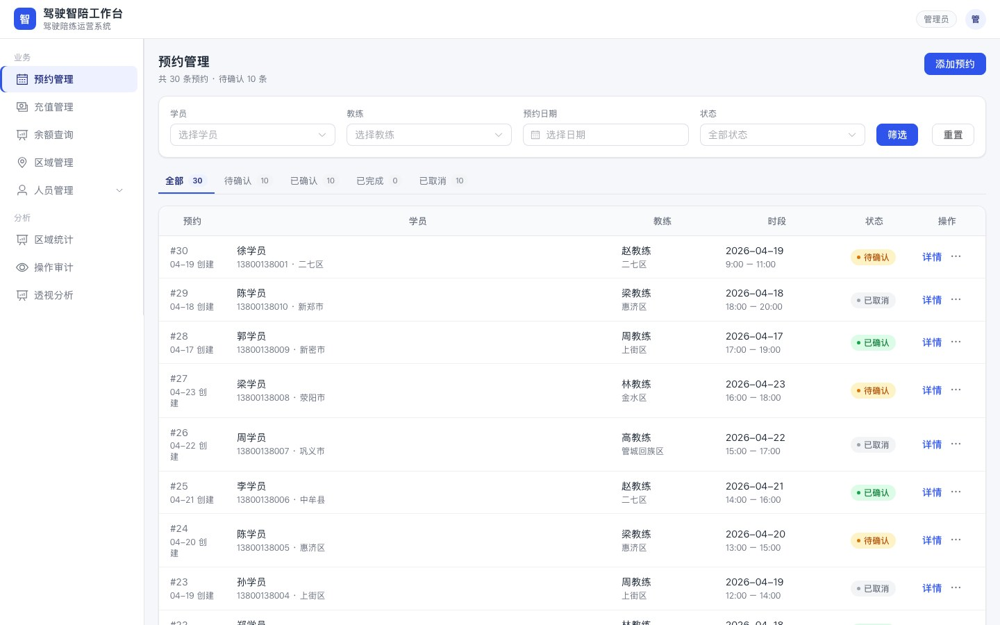
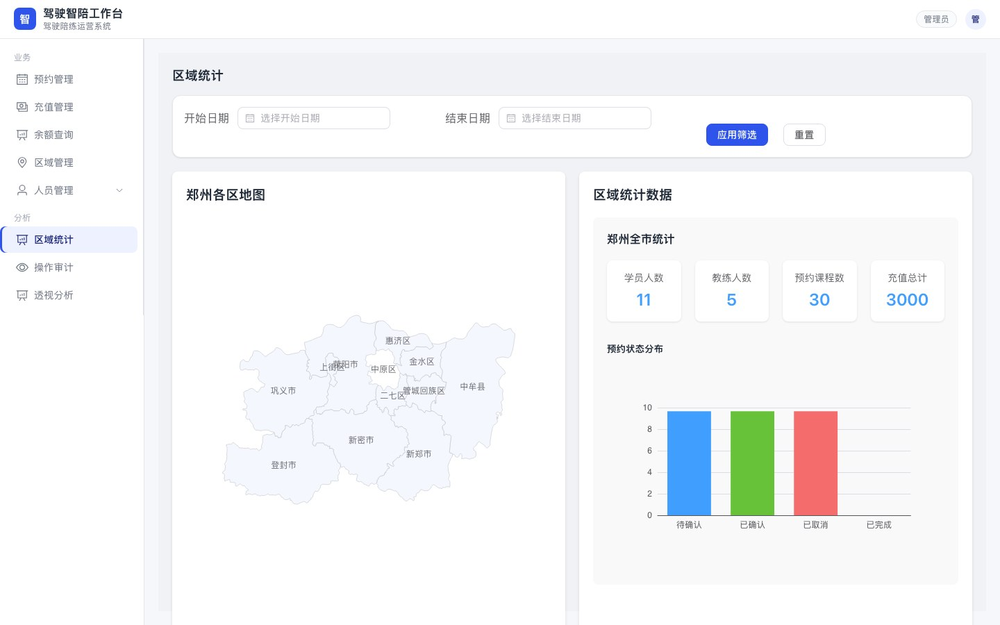
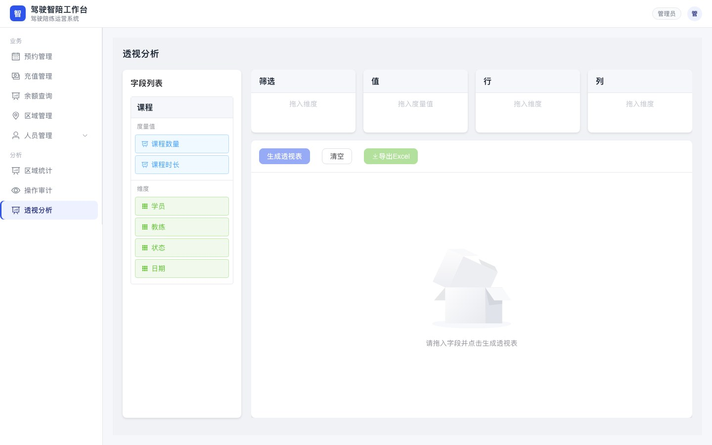
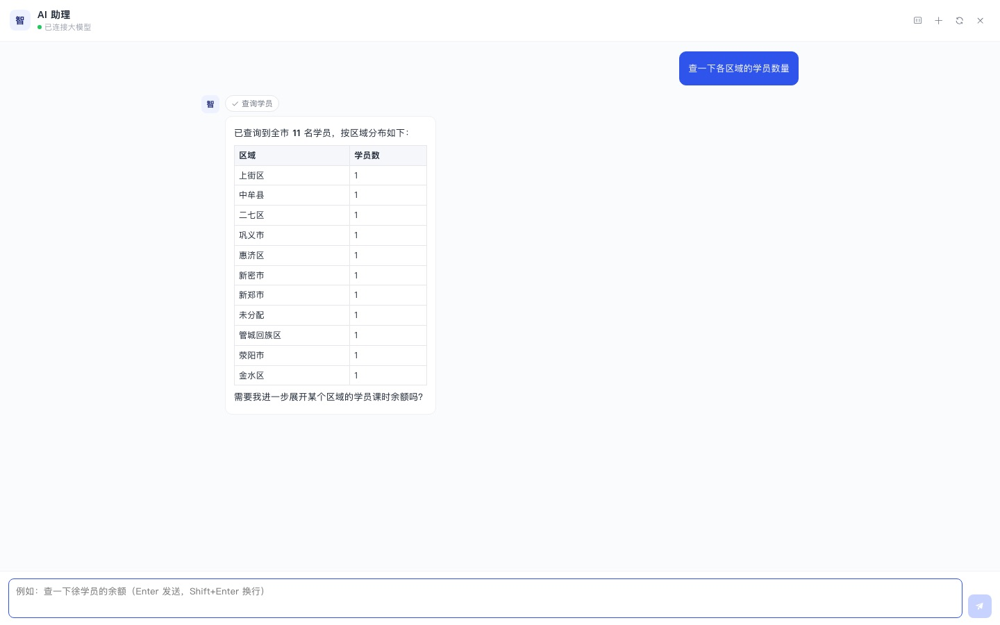
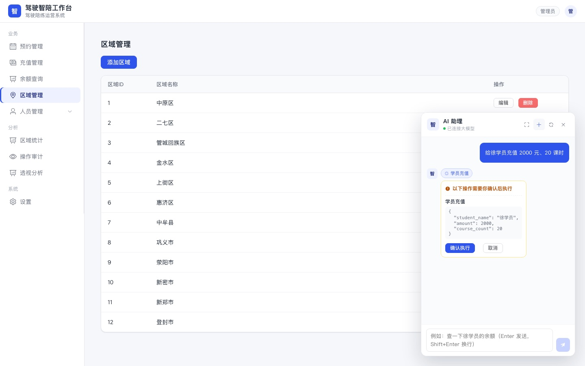
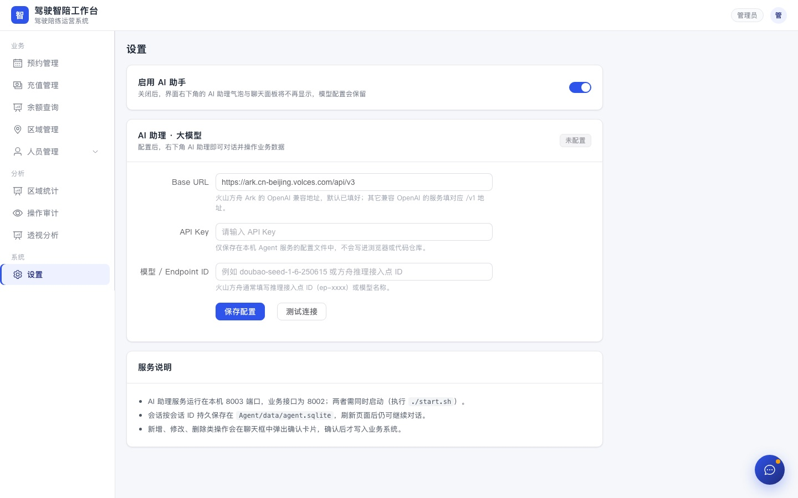
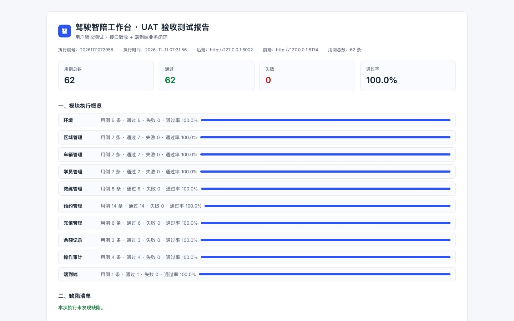

# 驾驶智陪工作台

## 简介
这个是我 Vibe Coding 练手的一个项目。
不同于先前的另外一个项目，那个项目强调多角色，这个项目只关注管理员角色。
项目的来源是我的驾驶陪驾教练，苦于一直没有一个系统来维护他们的业务信息。
于是我根据他们业务比较浅显的理解，简单搭建了这个系统。

## 功能
驾驶智陪工作台，面向刚拿到驾驶证还不敢上路，以及长时间没开车需要重新熟悉驾驶的司机。
学员联系平台管理员，说明地点和时间，然后由管理员指派教练。
系统只有一个管理员角色，学员、教练和车辆的信息都靠管理员来维护。
系统支持对接小龙虾，用户可以在微信里下各种指令来操作系统，这个项目的技术尝试主要是为了这个。

当前包含的模块：

- **预约管理**：预约的创建、确认、取消、完成、删除，按学员/教练/日期/状态筛选，分页浏览。
- **充值管理**：充值记录的新增、修改、删除，按学员筛选。
- **余额查询**：按学员查看充值与课时消耗流水，含课时结余，可下钻查看充值/预约详情。
- **区域管理**：训练区域的新增、重命名、删除。
- **学员管理**：学员档案（姓名、手机号、区域、驾龄、备注）。
- **教练管理**：教练档案（姓名、手机号、区域）与可执教车辆的关联维护。
- **车辆管理**：教练车辆（车型、品牌、型号）的维护。
- **区域统计**：按日期范围统计各区域的预约量与完成情况。
- **操作审计**：记录预约、充值等关键操作，可按学员/教练追溯。
- **透视分析**：拖拽维度与度量值生成透视表，支持导出 Excel。
- **AI 助理**：常驻界面右下角的对话助手，用自然语言查询学员、余额、预约与统计；新增、修改、删除等写操作先弹出确认卡，批准后才写入系统。
- **设置**：配置大模型 Base URL、API Key 与模型 / Endpoint ID，并可随时启用或停用 AI 助理。

## 界面预览

**预约管理**：按状态标签切换、按学员/教练/日期/状态筛选，行内「⋯」菜单完成确认、取消、编辑与删除。



**区域统计**：按日期范围统计全市学员、教练、预约与充值数据，并展示预约状态分布。



**透视分析**：拖拽维度与度量值生成透视表，支持导出 Excel。



**AI 助理**：右下角常驻对话面板，可收成气泡；提问即可查询业务数据，写操作先给出确认卡。



**AI 助理审批**：新增、修改、删除等动作会列出即将执行的内容，点「确认执行」才真正落库。



**设置**：填写大模型 Base URL、API Key 与模型 / Endpoint ID，并可一键停用 AI 助理。



更多页面与逐项操作说明见 [USERGUIDE.md](USERGUIDE.md)。

## Vibe Coding平台
- TRAE CN
- Doubao-Seed 2.0 code
- DBeaver CE
- MacOS

## 技术架构
- Vue3 + Element Plus + ECharts + Vite（前端）
- FastAPI（Python 3.11，后端）
- DAO（手写 SQL，没有使用 SQLAlchemy）
- SQLite
- deepagents + LangGraph + LangChain（AI 助理服务，独立进程、端口 8003）
- 豆包 / 火山方舟 Ark（大模型服务，OpenAI 兼容接口）

前后端通过 Vite 代理对接：前端 `/api/*` 请求转发到后端 `http://localhost:8002`，`/agent-api/*` 转发到 AI 助理服务 `http://localhost:8003`，无需在前端硬编码地址。

## 目录结构

```
DRVACLAW/
├── Backend/            FastAPI 服务、DAO、schema、SQLite 数据库与初始化脚本
│   ├── dao/            数据访问层（区域/车辆/学员/教练/预约/充值/余额/审计）
│   ├── routers/        接口路由（/api/areas、/api/vehicles、/api/students ...）
│   ├── schemas/        Pydantic 数据模型
│   └── db/             建库建表、迁移与测试数据脚本
├── Frontend/           Vue3 管理端
│   └── src/
│       ├── api/        接口封装（统一走 /api，AI 走 /agent-api）
│       ├── views/      各业务页面（含设置页 Settings.vue）
│       ├── components/ 公共组件（AIAssistant.vue 常驻聊天框）
│       └── composables/ 公共逻辑
├── Agent/              AI 助理服务（FastAPI + deepagents，端口 8003）
│   ├── server.py       SSE 流式对话、会话持久化、配置与审批接口
│   ├── agent_factory.py deepagents 图构建与 SKILLS 技能装载
│   ├── tools.py        29 个业务工具（查询 10 + 写操作 19）
│   └── config.py       模型配置读写（Agent/data/config.json）
├── TEST/UAT/           验收测试套件、报告与逐用例截图
├── docs/images/        README 与用户手册使用的界面截图
├── SKILLS/             对接小龙虾的 Skill
├── .trae/skills/       TRAE 侧技能定义
├── start.sh / stop.sh  一键启动 / 停止
└── README.md / USERGUIDE.md
```

## 快速开始

### 一键启动
```bash
./start.sh
```
后端运行在 `http://localhost:8002`，AI 助理服务运行在 `http://localhost:8003`，前端固定在 `http://localhost:5174`。停止服务执行 `./stop.sh`。

首次使用 AI 助理前，打开左侧「设置」，填写大模型 Base URL、API Key 与模型 / Endpoint ID，点「保存配置」并按「测试连接」确认连通；不想使用时关闭「启用 AI 助手」即可隐藏聊天框。

### 手动启动
```bash
# 后端
cd Backend
python3 -m uvicorn main:app --host 0.0.0.0 --port 8002 --reload

# 前端
cd Frontend
npm install
npm run dev

# AI 助理（使用项目内独立 Python 3.11 运行时）
cd Agent
.venv/bin/python -m uvicorn server:app --host 0.0.0.0 --port 8003
```

AI 助理依赖见 `Agent/requirements.txt`，运行时与环境位于 `Agent/runtime`、`Agent/.venv`（均不纳入版本控制）。

首次使用需初始化数据库：
```bash
cd Backend
python db/init_db.py              # 建表
python db/init_data4testing.py   # 可选：生成测试数据
```

接口文档：`http://localhost:8002/docs`。

## 测试与质量

`TEST/UAT` 内置 62 条验收用例，覆盖环境可达性、区域、车辆、学员、教练、预约全生命周期、充值与余额记账、操作审计，以及「充值 → 预约 → 确认 → 完成 → 余额扣减 → 审计追溯」端到端闭环。

```bash
cd TEST/UAT
../../Backend/.venv/bin/python3 uat_test_suite.py
```

执行后会生成：

- `report/UAT_TEST_REPORT.html` 验收报告（段落式，逐用例附真实业务页面截图，关键数据以红色边框标注）
- `report/results.json`（原始结果）、`report/junit.xml`（JUnit 标准结果）
- `report/screenshots/`（每条用例的执行现场截图）

测试数据使用 `UAT-` 前缀与专用手机号段，执行结束按依赖顺序自动清理。



本轮同时完成了一轮质量整改：后端事务与审计写入原子化、外键约束开启、404/400 错误语义统一、索引与分页补齐、DAO 连接管理收敛；前端修复分页失效、后端地址硬编码、路由懒加载、loading 与空状态处理。当前 UAT 62/62 通过。

## 开发备注
### 关于让系统自动发送微信消息
尝试过在系统里点击一个按钮，然后自动给学员或者教练发送微信。可以在网络上查到方法，但是已经被腾讯以安全的理由禁用。
### 关于SKILL
为了对接龙虾，我依次尝试了如下三个方式的SKILL，来对接龙虾：
- 封装方法给SKILL，这样做的话龙虾就完全指望你封装了哪些方法。
- 用TEXT2SQL的方案，技术上可行，但是有些关联性操作，比如插入数据同时插入一条审计记录这样的逻辑，大模型无法知道知道需要这样的关联操作。
- 最后决定类似Agent tools的方法，就是把FastAPI的接口直接告诉大模型，让大模型自己去判断该调用哪个。


## 吐槽
AI生成的代码，有些地方我个人不是很认同。
比如在这个项目里，有一个地方需要先根据学员的手机号来获取学员的ID，正常来说我们直接用手机号去搜索就可以，结果AI的代码是先把所有学员数据都拿过来，然后遍历，找到匹配的学员。这个方式在这种驾驶陪练的系统中可行，但是如果面向其它系统如果数据量比较大那么就很暴露很大的性能问题。

## 演示视频
https://b23.tv/qwDWH6K


## 更新日志
- 2026-11-11：新增常驻 AI 助理（deepagents 会话、SKILLS 技能装载、29 个业务工具、写操作人工审批、SSE 流式输出），以及设置页（大模型 Base URL / API Key 配置、AI 助手启停、聊天框最大化与恢复）。
- 2026-11-11：完成 P0–P2 质量整改并补充 UAT 验收测试（62 条用例全部通过，报告附逐用例截图）。
- 2026-04-17：添加数据透视分析功能。
- 2026-04-13：测试把接口直接暴露给大模型，让大模型自己去判断用哪个接口。
- 2026-04-12：添加SKILL相关支持代码，封装了三个固定的方法在SKILL里让大模型去调用。
- 2026-04-11：添加审计相关模块。
- 2026-04-10：添加充值相关模块。
- 2026-04-09：基础功能搭建。
