# 驾驶智陪工作台 - 用户使用手册

## 系统简介

驾驶智陪工作台是一款专为驾驶陪练机构设计的管理软件，帮助管理员高效维护学员、教练、车辆、预约、充值与课时余额等业务，并可通过小龙虾（微信指令）远程操作。

系统内置常驻 AI 助理，可直接用自然语言查询业务数据、发起业务操作；所有写操作都需要管理员在确认卡中批准后才会执行。

系统只有管理员一种角色，所有基础资料与业务操作均由管理员完成。

## 界面导航

系统采用「顶部标题栏 + 左侧菜单 + 右侧内容区」的布局：

- **业务**：预约管理、充值管理、余额查询、区域管理、人员管理（学员 / 教练 / 车辆）。
- **分析**：区域统计、操作审计、透视分析。
- **系统**：设置（启用 AI 助手、配置大模型 Base URL / API Key / 模型）。

点击左侧菜单即可切换到对应功能页面，当前页面会高亮显示。界面右下角另有 AI 助理气泡，点击可展开聊天面板。

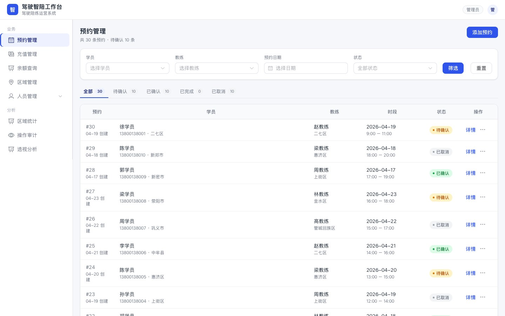

*图 1 预约管理页面（默认进入的业务页面）*

## 系统功能

系统主要包含以下功能模块：

1. **预约管理**：课程的创建、确认、取消、完成与删除，支持按学员、教练、日期、状态筛选。
2. **充值管理**：学员充值记录的新增、修改、删除。
3. **余额查询**：查看学员的充值与课时消耗流水及课时结余，可下钻查看充值/预约详情。
4. **区域管理**：训练区域的新增、重命名、删除。
5. **学员管理**：学员档案（姓名、手机号、区域、驾龄、备注）维护。
6. **教练管理**：教练档案（姓名、手机号、区域）与可执教车辆关联的维护。
7. **车辆管理**：教练车辆（车型、品牌、型号）的维护。
8. **区域统计**：按日期范围统计各区域的预约量、完成情况。
9. **操作审计**：记录预约、充值等关键操作，可按学员、教练追溯。
10. **透视分析**：拖拽维度与度量值生成透视表，并支持导出 Excel。
11. **AI 助理**：右下角常驻对话助手，可查询学员、余额、预约、审计与区域统计；新增、修改、删除等写操作需在确认卡中批准后执行。
12. **设置**：配置大模型 Base URL、API Key 与模型 / Endpoint ID，测试连通性，并可启用或停用 AI 助手。

## 系统环境

### 后端环境
- Python 3.11
- FastAPI
- SQLite

### 前端环境
- Vue 3
- Element Plus
- ECharts
- Vite

### AI 助理环境
- Python 3.11（项目内独立运行时：`Agent/runtime` + `Agent/.venv`）
- FastAPI + deepagents + LangGraph（独立服务，端口 8003）
- 大模型：豆包 / 火山方舟 Ark（OpenAI 兼容接口，需可访问外网）

## 系统安装与启动

### 一键启动（推荐）
在项目根目录执行：

```bash
./start.sh
```

- 后端：`http://localhost:8002`
- AI 助理：`http://localhost:8003`
- 前端：`http://localhost:5174`
- 接口文档：`http://localhost:8002/docs`

停止服务执行 `./stop.sh`。

### 后端启动（手动）
1. 进入后端目录：`cd Backend`
2. 激活虚拟环境：`source .venv/bin/activate`（Mac/Linux）或 `.venv\Scripts\activate`（Windows）
3. 初始化数据库（首次使用）：`python db/init_db.py`，可选执行 `python db/init_data4testing.py` 生成测试数据
4. 启动后端服务：`python main.py`
5. 后端服务默认运行在 `http://localhost:8002`

### 前端启动（手动）
1. 进入前端目录：`cd Frontend`
2. 安装依赖：`npm install`
3. 启动前端服务：`npm run dev`
4. 浏览器打开 `http://localhost:5174`

前端所有接口请求统一走 `/api`，由 Vite 代理转发到后端；AI 助理请求走 `/agent-api`，转发到 `127.0.0.1:8003`，均无需手动配置地址。

### AI 助理服务启动（手动）
1. 进入目录：`cd Agent`
2. 启动服务：`.venv/bin/python -m uvicorn server:app --host 0.0.0.0 --port 8003`
3. 浏览器访问 `http://localhost:8003/health`，返回 `{"ok":true,"model_ready":...}` 即服务正常
4. 首次使用请在左侧「设置」填写大模型 Base URL、API Key 与模型 / Endpoint ID，点「测试连接」验证

## 功能操作指南

## 1. 预约管理

### 功能说明
预约管理是系统的核心页面，用于管理学员的课程预约：创建预约、确认、取消、标记完成、删除，并按学员 / 教练 / 日期 / 状态快速筛选。

### 页面结构
页面由三部分组成：

- **顶部统计与操作区**：显示「共 N 条预约 · 待确认 N 条」，右侧「添加预约」按钮用于创建新预约。
- **筛选区**：学员、教练、预约日期、状态四个筛选条件，配合「筛选」「重置」按钮。
- **状态标签**：`全部 / 待确认 / 已确认 / 已取消 / 已完成`，标签后的数字为该状态的预约数量，点击标签只显示该状态的数据。
- **预约列表**：每行显示预约编号与创建时间、学员姓名/手机号/区域、教练姓名/区域、预约时段、状态与操作按钮。列表按预约编号倒序排列，最新的在最上方，并支持分页。

### 操作步骤

**（1）切换状态查看**
点击状态标签（如「待确认」）即可只看该状态的预约；点击「全部」恢复所有数据。

**（2）筛选预约**
1. 在「学员」下拉框中选择学员（支持输入姓名/手机号搜索）；
2. 在「教练」下拉框中选择教练；
3. 在「预约日期」中选择日期；
4. 在「状态」中选择预约状态；
5. 点击「筛选」按条件查询，点击「重置」清空全部条件。

**（3）新增预约**
1. 点击右上角「添加预约」；
2. 在弹窗中依次选择学员、教练；
3. 填写预约日期；
4. 设置开始时间与结束时间（整点选择，取值 1–24）；
5. 选择状态（默认「待确认」）；
6. 点击「保存」提交，保存成功后列表立即出现新预约。

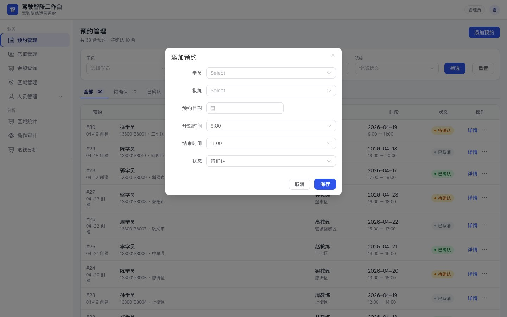

*图 2 添加预约弹窗：学员、教练、预约日期、开始/结束时间、状态*

**（4）查看预约明细**
在列表行点击「详情」，弹窗按「预约信息 / 学员信息 / 教练信息」三段展示预约编号、预约日期、预约时段、状态、创建时间，以及学员和教练的姓名、手机号、区域。

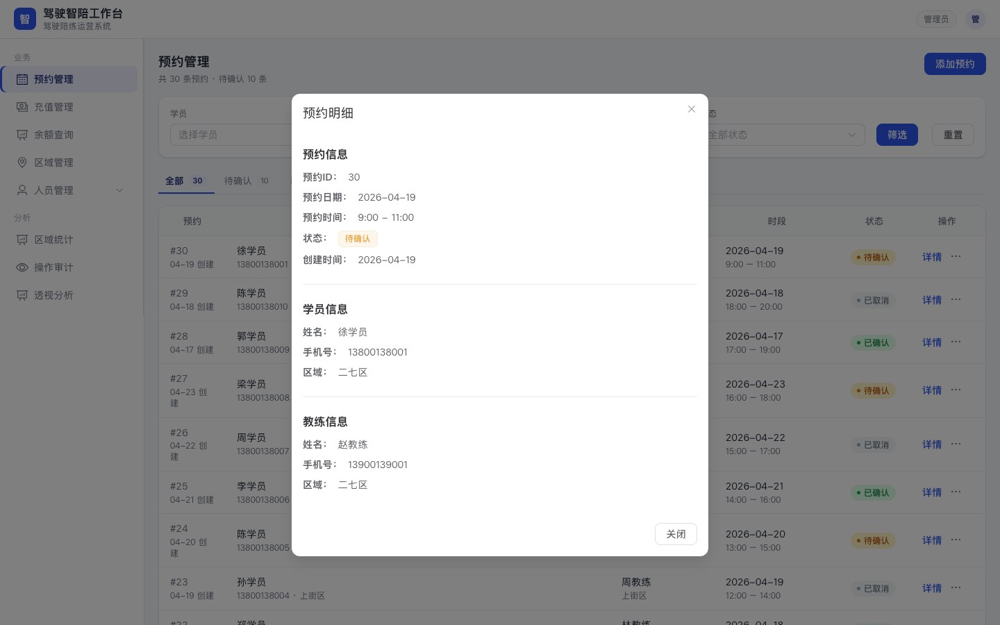

*图 3 预约明细弹窗*

**（5）确认、取消、编辑与删除**
在列表行点击「⋯」打开操作菜单，菜单中包含「确认」「取消预约」「编辑」「删除」等操作。

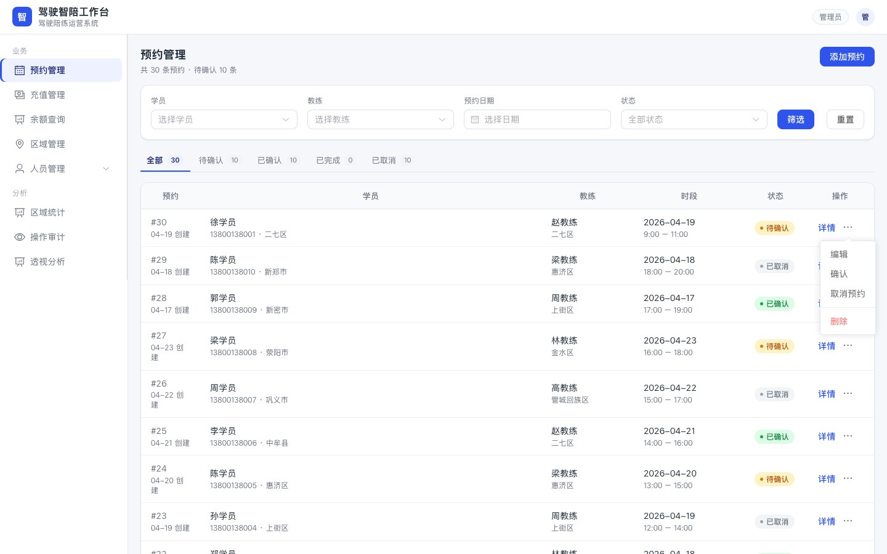

*图 4 预约操作菜单（⋯）*

- **确认预约**：对待确认的预约执行「确认」，状态变为「已确认」，同时写入一条审计日志。
- **取消预约**：执行「取消预约」，状态变为「已取消」。
- **标记完成**：编辑预约并将状态改为「已完成」。系统会按预约时段自动生成一条课时消耗的余额记录（结余减少），并写入审计日志。
- **删除预约**：执行「删除」，该预约从列表移除。

### 注意事项
- 开始、结束时间须在 1–24 之间，且结束时间必须晚于开始时间，否则保存失败并提示「结束时间必须晚于开始时间」。
- 状态只能是「待确认 / 已确认 / 已取消 / 已完成」，其他取值会被拒绝。
- 已完成预约再次标记完成不会重复扣减课时。
- 将「已完成」的预约改回其他状态（如已确认、已取消）时，系统会自动撤销对应的课时消耗记录。
- 预约必须关联已存在的学员与教练，引用不存在的学员或教练会返回错误提示。

---

## 2. 充值管理

### 功能说明
用于录入学员的充值信息，并自动生成对应的课时余额记录；修改课时数会自动重算余额，删除充值会同步清理对应余额记录。

### 页面结构
列表展示充值编号、学员姓名/手机号、充值金额、课程数量、充值时间与操作按钮；右上角为「添加充值」入口。

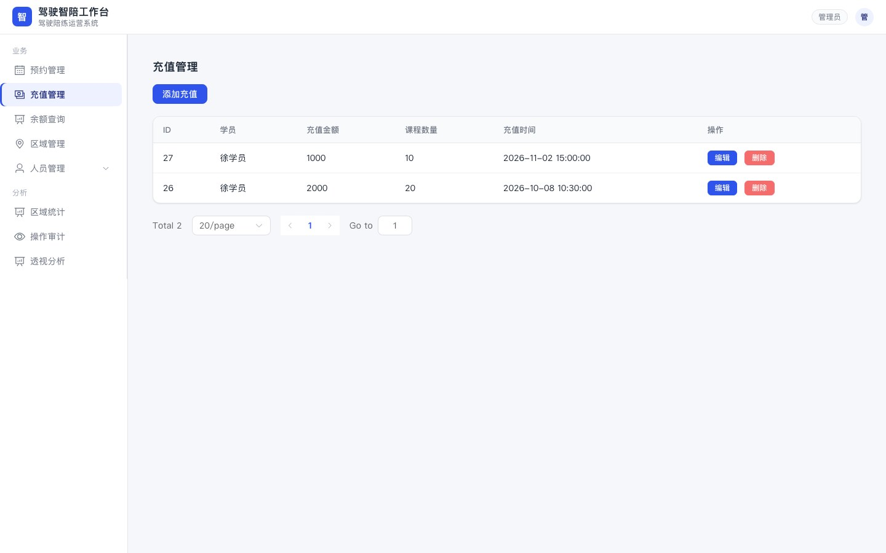

*图 5 充值管理页面*

### 操作步骤

**（1）新增充值**
1. 点击「添加充值」；
2. 选择学员（支持搜索）；
3. 填写充值金额（元）；
4. 填写课程数量（课时）；
5. 选择充值时间（默认当前时间）；
6. 点击「确定」保存。

保存成功后，系统会自动在「余额查询」中生成一条充值记录，结余等于该学员现有结余加上本次课时数。

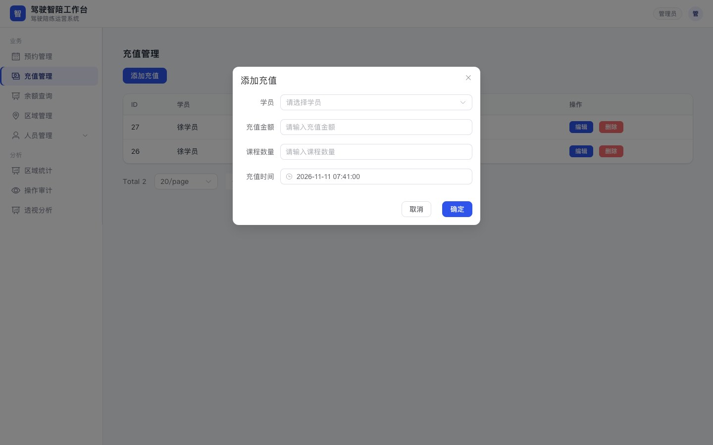

*图 6 添加充值弹窗*

**（2）修改充值**
在列表行点击「编辑」，修改金额、课程数量或充值时间后保存，系统会自动重算该学员的课时结余。

**（3）删除充值**
在列表行点击「删除」，该充值记录与其对应的余额记录会被一并清理。

### 注意事项
- 修改课程数量后，历史课时消耗记录保持不变，结余按「充值课时 − 已消耗课时」重新计算。
- 删除充值时，如果对应余额记录已产生后续消耗，请先确认数据是否需要保留。
- 充值时间使用北京时间，格式为 `YYYY-MM-DD HH:MM:SS`。

---

## 3. 余额查询

### 功能说明
查看学员的充值与课时消耗流水，实时掌握每个学员的课时结余，并可下钻查看充值、预约的详细信息。

### 页面结构
顶部为学员筛选下拉框；列表依次展示学员、区域、日期、课时、结余、类型，以及「充值详细信息」「课程预约详细信息」两列操作（「查看」按钮）。

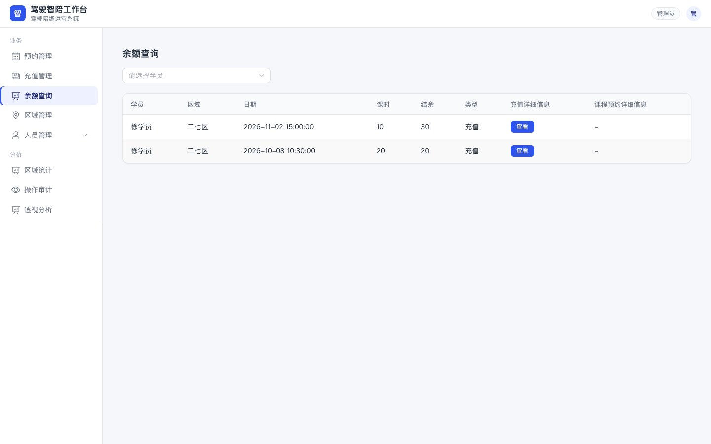

*图 7 余额查询页面*

### 操作步骤

**（1）筛选学员**
在顶部下拉框选择学员（支持输入姓名搜索）；不选择时展示全部学员的记录。清空选择即恢复全部数据。

**（2）查看充值详情**
在「充值详细信息」列点击「查看」，弹窗展示充值编号、学员、充值金额、课程数量、充值时间。

**（3）查看预约详情**
在「课程预约详细信息」列点击「查看」，弹窗展示预约编号、学员、教练、预约日期、开始/结束时间、状态与创建时间。

### 注意事项
- 列表按记录倒序排列，最新记录在最上方。
- 类型为「充值」的记录课时为正数，「课程消耗」的记录课时为负数，结余为累计结果。
- 系统不校验结余是否足够，完成预约会照常生成负课时记录，结余可能出现负数，请及时联系学员充值。

---

## 4. 区域管理

### 功能说明
维护训练区域（如各区县），供学员、教练与统计页面使用。

### 页面结构
列表展示区域编号、区域名称与操作按钮，右上角为「添加区域」。

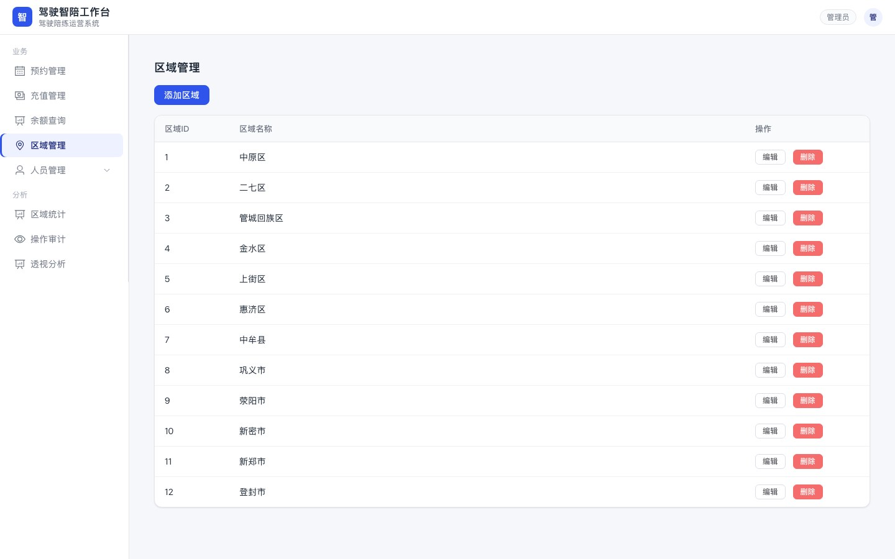

*图 8 区域管理页面*

### 操作步骤
1. **新增区域**：点击「添加区域」，填写区域名称后点击「保存」。
2. **重命名区域**：在列表行点击「编辑」，修改名称后保存。
3. **删除区域**：在列表行点击「删除」。

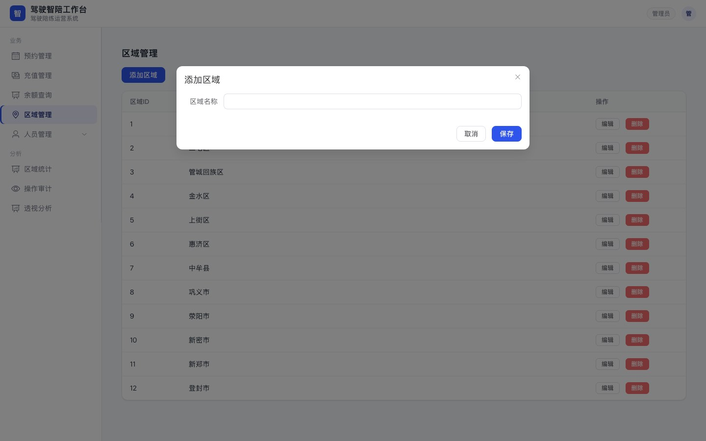

*图 9 添加区域弹窗*

### 注意事项
- 区域名称不可重复，重名会被拒绝并提示。
- 删除区域时，引用该区域的学员、教练与余额记录中的区域字段会被置空，不会阻断删除。

---

## 5. 学员管理

> 菜单路径：左侧「人员管理 → 学员管理」。

### 功能说明
维护学员档案，是预约、充值与余额业务的基础数据。

### 页面结构
列表展示学员编号、姓名、手机号、区域、驾龄、备注、注册时间与操作按钮；右上角为「添加学员」。

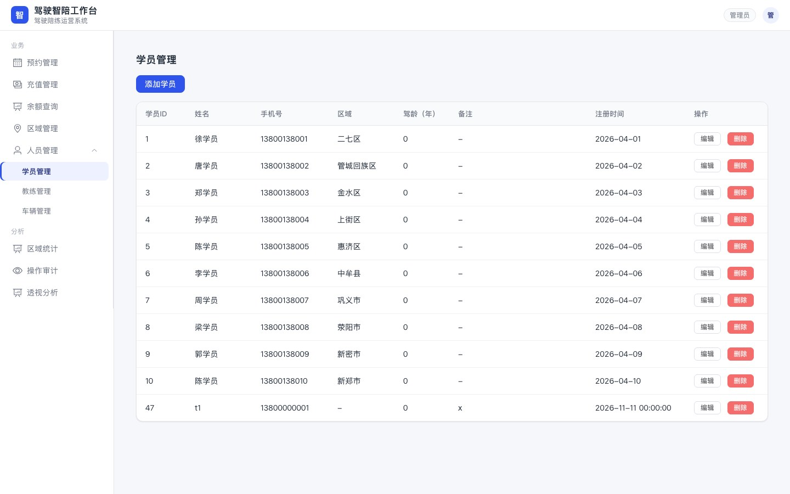

*图 10 学员管理页面*

### 操作步骤
1. **新增学员**：点击「添加学员」，填写姓名、手机号，选择区域，设置驾龄（年），可填写备注，点击「保存」。
2. **编辑学员**：在列表行点击「编辑」，修改后保存。
3. **删除学员**：在列表行点击「删除」。

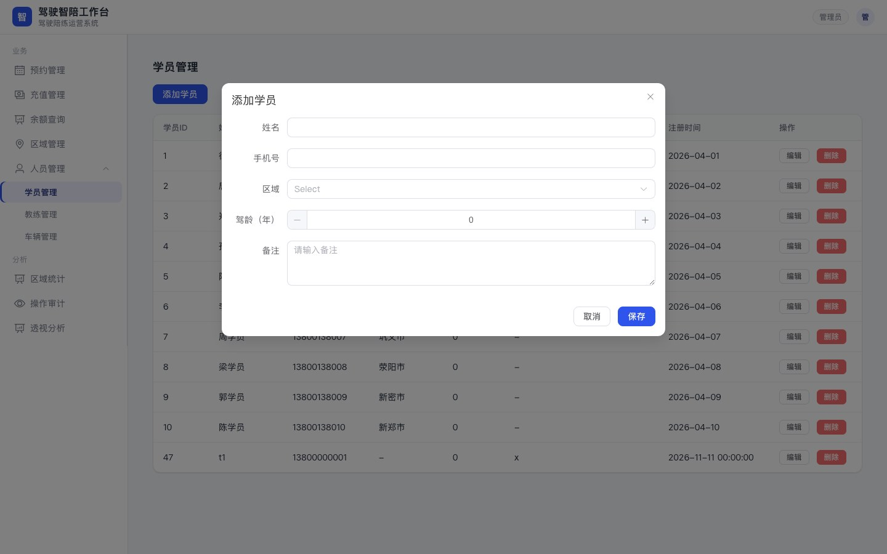

*图 11 添加学员弹窗*

### 注意事项
- 手机号不可重复，重复会被拒绝。
- 驾龄为 0 表示新拿证学员，可用于筛选需要重点陪练的学员。
- 删除学员会同时清理该学员的余额记录、预约与充值记录；审计日志保留，仅解除学员关联。

---

## 6. 教练管理

> 菜单路径：左侧「人员管理 → 教练管理」。

### 功能说明
维护教练档案及其可执教车辆，预约时只能选择已存在的教练。

### 页面结构
列表展示教练编号、姓名、手机号、区域、关联车辆与操作按钮；右上角为「添加教练」。

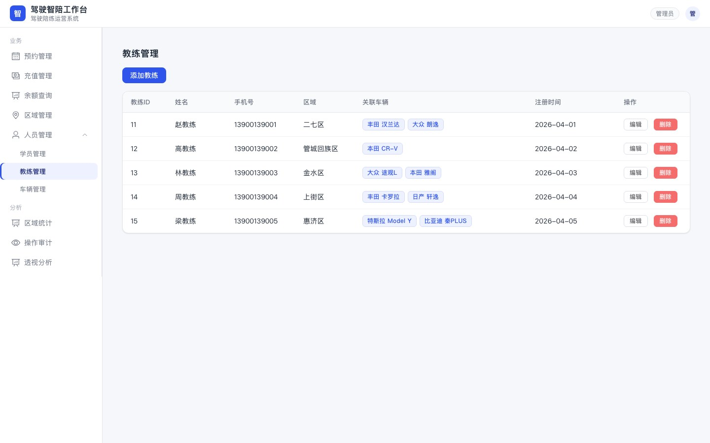

*图 12 教练管理页面*

### 操作步骤
1. **新增教练**：点击「添加教练」，填写姓名、手机号，选择区域，在「关联车辆」中多选该教练可使用的车辆，点击「保存」。
2. **编辑教练**：在列表行点击「编辑」，可调整区域或增减车辆关联后保存。
3. **删除教练**：在列表行点击「删除」。

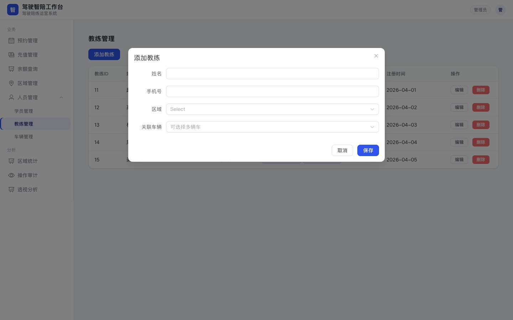

*图 13 添加教练弹窗（含关联车辆多选）*

### 注意事项
- 手机号不可重复。
- 关联车辆可多选，未选择车辆时教练仍可保存，但排课时需确认车辆安排。
- 删除教练会同时清理其预约记录与车辆关联；审计日志保留，仅解除教练关联。

---

## 7. 车辆管理

> 菜单路径：左侧「人员管理 → 车辆管理」。

### 功能说明
维护教练车辆信息，供教练关联与排课使用。

### 页面结构
列表展示车辆编号、车型、品牌、型号与操作按钮；右上角为「添加车辆」。

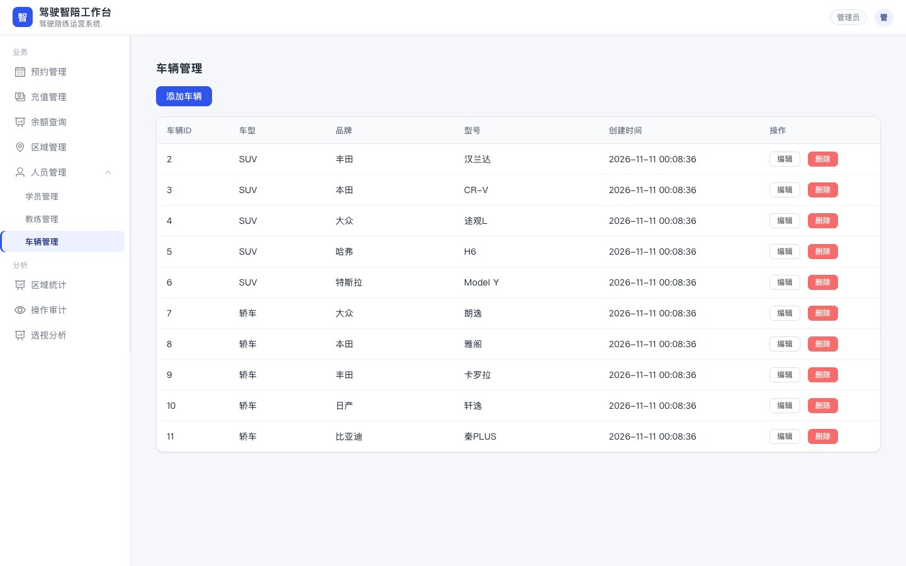

*图 14 车辆管理页面*

### 操作步骤
1. **新增车辆**：点击「添加车辆」，选择车型（SUV / 轿车），填写品牌与型号，点击「保存」。
2. **编辑车辆**：在列表行点击「编辑」，修改后保存。
3. **删除车辆**：在列表行点击「删除」。

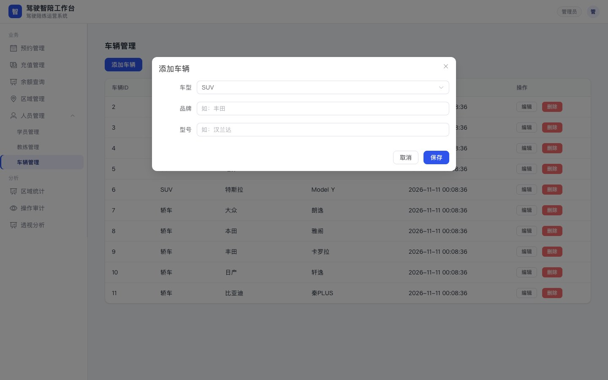

*图 15 添加车辆弹窗*

### 注意事项
- 车型只能是「SUV」或「轿车」，其他取值会被拒绝。
- 删除车辆会自动解除教练对该车辆的关联，不影响教练本身。

---

## 8. 区域统计

### 功能说明
按日期范围统计各区域的业务数据，直观查看全市概况与预约状态分布。

### 页面结构
- **筛选区**：开始日期、结束日期与「应用筛选」「重置」按钮。
- **左侧地图**：按区域展示分布。
- **右侧统计**：全市概览（学员人数、教练人数、预约课程数、充值总计）与预约状态分布柱状图。

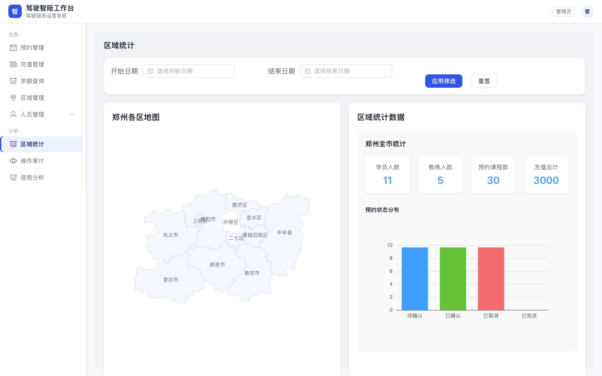

*图 16 区域统计页面*

### 操作步骤
1. 选择开始日期与结束日期；
2. 点击「应用筛选」按区间统计；
3. 点击「重置」恢复全部区间；
4. 查看统计卡片与柱状图（待确认 / 已确认 / 已取消 / 已完成）。

### 注意事项
- 未选择日期时统计全部数据；日期区间包含起止当天。
- 统计结果为实时计算，新增预约或充值后刷新页面即可看到变化。

---

## 9. 操作审计

### 功能说明
记录系统中的关键业务操作，便于事后追溯「谁在什么时间做了什么、结果如何」。

### 页面结构
顶部为学员、教练筛选与「查询」「重置」按钮；列表展示审计编号、操作人、学员、教练、操作时间、操作类型、操作结果。

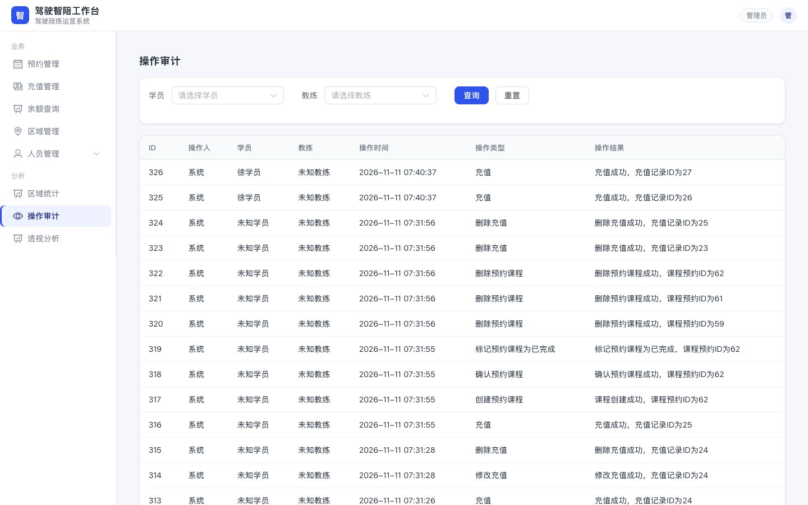

*图 17 操作审计页面*

### 操作步骤
1. 在「学员」或「教练」下拉框中选择对象；
2. 点击「查询」按条件追溯；
3. 点击「重置」恢复全部记录；
4. 在列表中查看操作类型（创建预约、确认预约、标记完成、充值、修改充值、删除充值等）与操作结果。

### 注意事项
- 审计记录按操作时间倒序排列，最新的在最上方，并支持分页与每页条数切换。
- 预约确认、完成，充值新增、修改、删除等操作都会自动写入审计，无需手工维护。
- 对象被删除后，审计记录仍保留，学员/教练列显示为「未知学员」「未知教练」。

---

## 10. 透视分析

### 功能说明
自定义维度和度量值，快速生成多维交叉统计表，并支持导出 Excel 做进一步分析。

### 页面结构
左侧为可拖拽的维度与度量值字段；中间上方为「行维度 / 列维度 / 度量值」拖放区；下方为生成的透视表；右侧/顶部提供「生成透视表」「导出 Excel」「清空」按钮。

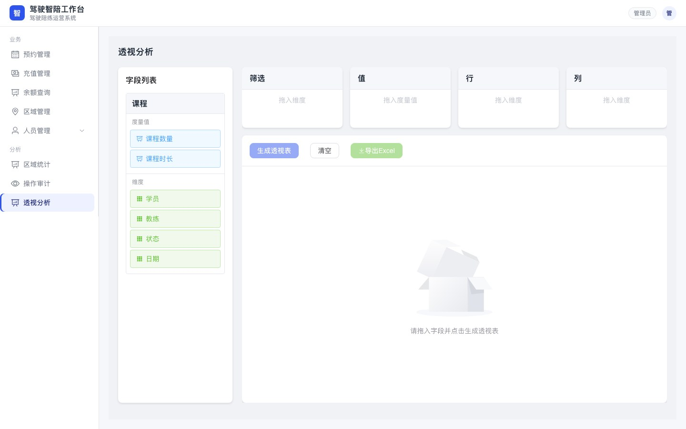

*图 18 透视分析页面*

### 操作步骤
1. 将所需字段拖入「行维度」「列维度」区域；
2. 将需要汇总的字段拖入「度量值」区域；
3. 点击「生成透视表」查看按维度汇总的结果；
4. 点击「导出 Excel」将当前结果导出为表格文件；
5. 点击「清空」重置已拖入的字段，重新开始分析。

### 注意事项
- 行列维度可组合使用，维度越多表格层级越细，建议先用 1–2 个维度确认口径。
- 导出内容与当前透视表一致，修改维度后需重新生成再导出。

---

## 11. AI 助理与设置

AI 助理是常驻在界面右下角的对话助手，可收起为气泡、展开为面板，也可一键铺满全屏。它通过自然语言调用系统接口：查询类操作直接返回结果，新增、修改、删除类操作会先弹出确认卡，需管理员批准后才会真正写入。

### 11.1 启用、停用与模型配置

1. 点击左侧「系统 → 设置」进入设置页；
2. 「启用 AI 助手」开关默认开启；关闭后右下角气泡与聊天面板立即隐藏，已保存的模型配置保留，再次开启即恢复；
3. 在「AI 助理 · 大模型」区域填写：
   - **Base URL**：模型服务地址，火山方舟默认为 `https://ark.cn-beijing.volces.com/api/v3`；
   - **API Key**：访问密钥，已保存时输入框显示掩码，留空表示不修改；
   - **模型 / Endpoint ID**：方舟控制台创建的推理接入点 ID（如 `ep-2024xxxx`）；
4. 点击「保存配置」保存，点击「测试连接」验证地址、密钥与模型是否可用；
5. 配置保存在 Agent 服务本机 `Agent/data/config.json`（权限 0600，不写入业务数据库）；`GET /config` 只返回掩码，不回传明文密钥。

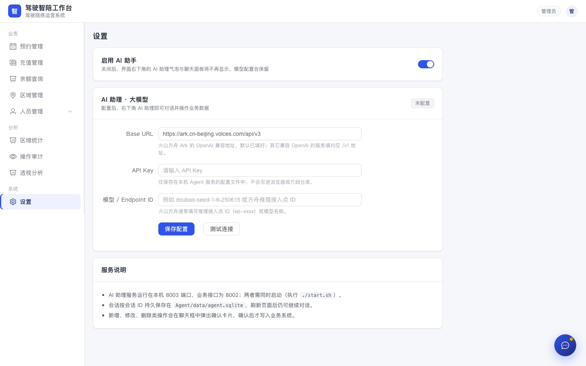

*图 19 设置页面：启用 AI 助手开关与大模型配置*

### 11.2 打开、收起与全屏

- 点击右下角圆形气泡展开面板，默认尺寸 380×600；
- 标题栏按钮从左到右依次为：最大化 / 恢复默认大小、新会话、刷新会话、最小化；
- 点击最大化后聊天面板铺满整个屏幕，按钮变为「恢复默认大小」，再次点击回到默认尺寸；
- 面板标题下方显示「已连接大模型」或「未配置大模型」；未配置时面板顶部会出现黄色提示与「去设置」按钮。

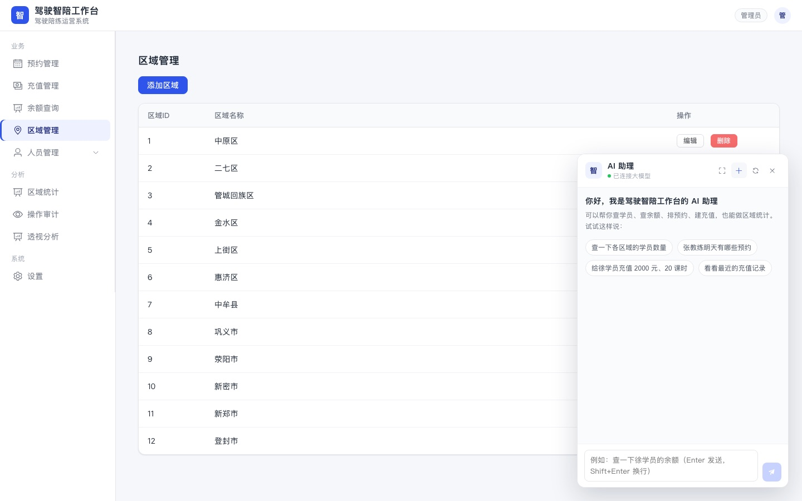

*图 20 AI 助理面板（默认尺寸，含示例问题）*

### 11.3 对话与查询

直接用日常语言提问即可，例如：

- 「查一下各区域的学员数量」
- 「张教练明天有哪些预约」
- 「徐学员的余额还有多少课时」
- 「看看最近的充值记录」

助理会自动调用对应接口并整理结果，查询结果以表格、列表等形式呈现，并显示所调用的工具（如「查询学员」）。

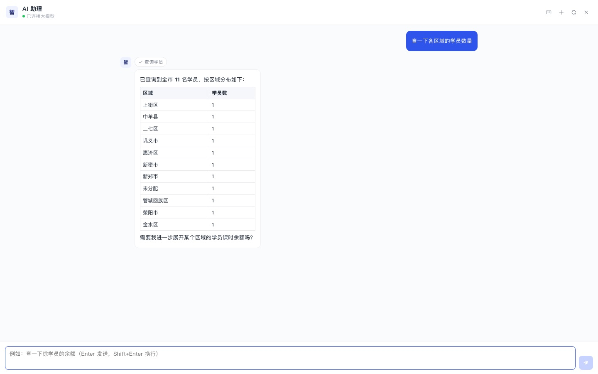

*图 21 AI 助理全屏对话：自然语言查询并返回区域学员分布*

### 11.4 写操作与审批

新增、修改、删除（含区域、学员、教练、车辆、预约、充值）会自动进入审批：

1. 助理在面板中弹出操作确认卡，列出工具名称与即将写入的参数；
2. 点击「确认执行」后才调用接口并写入数据库；
3. 点击「取消」则放弃本次操作，数据保持不变；
4. 执行完成后，助理会说明执行结果。

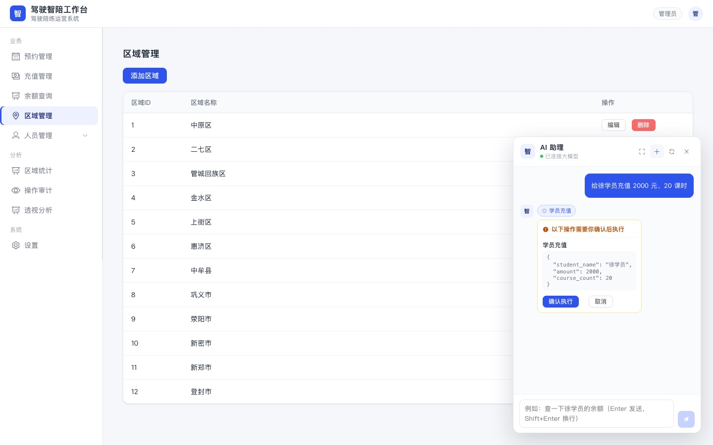

*图 22 写入前弹出操作确认卡，批准后才执行*

### 11.5 会话管理

- 同一会话内保留上下文，可连续追问（如先查区域，再查该区域的学员）；
- 点击标题栏「新会话」开启新会话并清空当前上下文；
- 点击「刷新会话」重新加载当前会话历史；
- 会话保存在 Agent 服务本地 SQLite（`Agent/data/agent.sqlite`），关闭浏览器后再次打开仍可继续。

### 注意事项
- AI 助理依赖 Agent 服务（8003）与模型服务的网络连通，服务未启动时面板会提示连接失败；
- 关闭「启用 AI 助手」只影响界面显示，不会删除模型配置与会话记录；
- 删除类操作同样需要人工确认，请仔细核对确认卡中的对象与参数。

---

## 数据规则与常见问题

- **唯一性约束**：区域名称、学员手机号、教练手机号均不可重复，冲突时接口返回 400 并提示原因。
- **删除行为**：删除学员/教练会级联清理其业务数据（预约、充值、余额、车辆关联），审计日志保留；删除区域/车辆会自动解除引用，不会因关联而失败。删除前请确认数据确已不再需要。
- **课时计算**：结余 = 充值课时 − 已完成课程消耗课时；充值修改与删除会触发结余重算。
- **分页**：预约、余额、审计等列表均提供分页与每页条数切换；区域、学员、教练、车辆为全量列表，数据直接滚动查看。
- **端口占用**：前端固定 5174，后端 8002，AI 助理 8003；如端口异常请先执行 `./stop.sh` 再启动。
- **数据初始化**：清空数据库可删除 `Backend/drvaclaw.db` 后重新执行 `python db/init_db.py`。

## 系统维护

### 数据库初始化
1. 进入后端目录：`cd Backend`
2. 执行建表脚本：`python db/init_db.py`
3. 执行测试数据脚本（可选）：`python db/init_data4testing.py`
4. 已有数据库升级时，可执行 `python db/migrate_student_coach.py`

### 数据备份
定期备份 `Backend/drvaclaw.db` 文件，防止数据丢失。

### 验收测试

项目内置 62 条 UAT 验收用例，覆盖环境、基础资料、预约全生命周期、充值与余额、审计及端到端闭环：

```bash
cd TEST/UAT
../../Backend/.venv/bin/python3 uat_test_suite.py
```

执行后生成 `report/UAT_TEST_REPORT.html`（逐用例附业务页面截图，关键数据以红色边框标注）、`report/results.json`、`report/junit.xml` 与 `report/screenshots/`。测试数据使用 `UAT-` 前缀，执行结束自动清理。

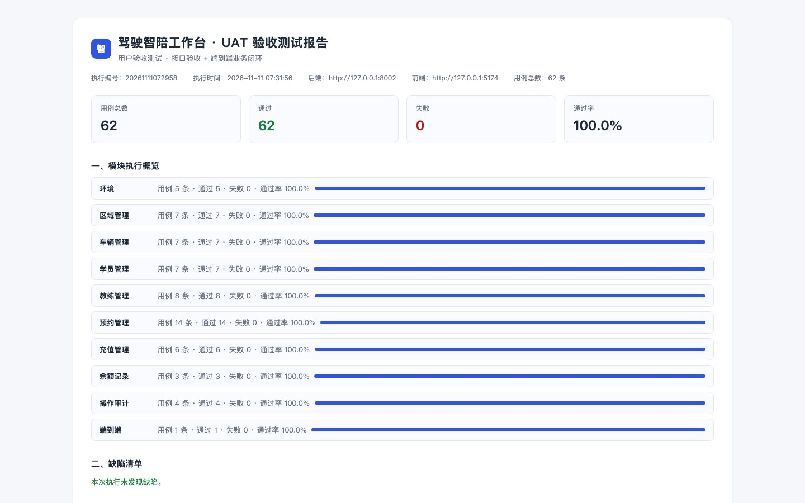

*图 23 UAT 验收测试报告*

## 联系方式

如果您在使用过程中遇到任何问题，请联系系统管理员，QQ：63036666

---

**版本**：v1.2.0
**更新时间**：2026-11-11
